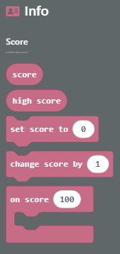
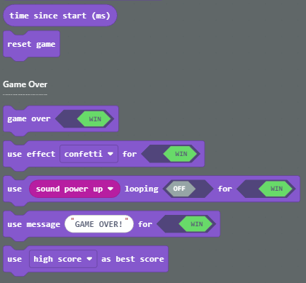

MakeCode Arcade has various built-in blocks for updating the player's score and keeping track of the best score. For example, blocks under the Info palette can be used to:
* Read the current score or best score from a variable.
* Set the score to a specific value.
* Increase or decrease the score.
* Take an action when the score reaches a specific value.

Blocks under the Game palette can be used to:
* Get the amount of time in milliseconds since the game started, which can be useful for calculating a player's score at the end.
* Reset the game.
* Show a Game Over dialog, including win/loss status, and with customizable sound effects and message.
* Specify whether a high score is best (such as in number of points achieved, or number of seconds survived) or a low score is best (such as in number of seconds to complete a course).

By default the game keeps track of the best score so that whenever the player wins, it will compare the player's score to the best score and display it in the final dialog. Note that if a player loses, the score is ignored.
