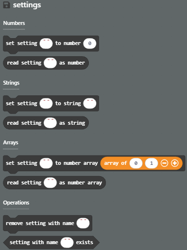
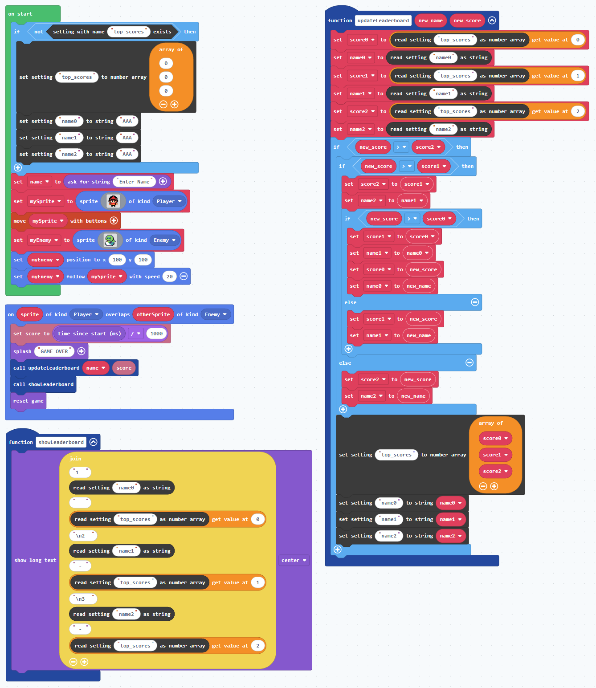

MakeCode Arcade has built-in capabilities for keeping track of the best score, as described in the Score lesson. If you want to keep track of more than just the top score, you'll need to build a leaderboard. We can do this using the "settings-blocks" extension, which provides a mechanism for saving game information across multiple game plays.

After adding the "settings-blocks" extension you will see a new palette containing blocks for:
* Setting and reading a value of type number, string, or array of numbers.
* Removing a previously stored value.
* Testing for the existence of a value by name.

Here is a sample implementation of a leaderboard that keeps track of the top 3 scores and player names:

These "settings" values can be used for other purposes as well. For example, a long multi-level game could provide the player with the ability to save progress by storing the current level along with current score and health points.